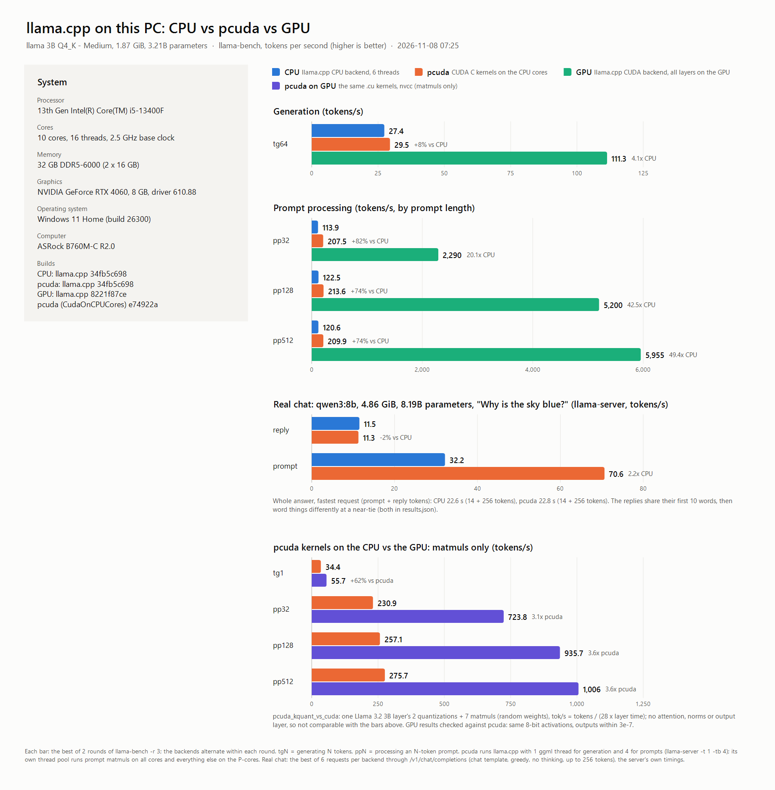

# Kernelcore: CUDA kernels on Windows x64 CPU cores (POC)

Kernelcore runs CUDA C kernels on the CPU of a normal Windows PC, with no NVIDIA GPU, CUDA Toolkit or driver.
[Booth](https://github.com/Zaneham/Booth) (`kath --cpu`) compiles each kernel to x86-64 code at build
time. The Kernelcore runtime loads that code and runs it behind a small CUDA-style API (`kcMalloc`,
`kcMemcpy`, `kcLaunchKernel`, streams, events).

CUDA is a trademark of NVIDIA Corporation. Kernelcore is an independent project, not affiliated with
or endorsed by NVIDIA.

It is a proof of concept, not a CUDA replacement. See `cuda_cpu_poc_plan.md` for the design and
`cuda_cpu_poc_plan_review.md` for why the design is Windows-native.

## Results: llama.cpp on an i5-13400F



As a llama.cpp backend, Kernelcore beats llama.cpp's own CPU backend on the same PC: Llama 3.2 3B
generates 31.7 vs 28.0 tokens/s (+13%) and reads prompts about 1.9× faster; a Qwen3 8B chat reply
runs 13.9 vs 11.7 tokens/s (+19%). The GPU (RTX 4060) still generates 3.5× faster than
Kernelcore. The bottom panel runs the same `.cu` kernels on the GPU through nvcc. Details in
[ggml backend](#ggml-backend-kernelcore-inside-llamacpp-ggml-kernelcore); redraw with
`scripts\bench_chart.ps1`.

## Quick start

```powershell
.\scripts\bootstrap.ps1 -FetchKath   # check toolchain; download pinned kath.exe (SHA-256 verified)
.\scripts\build.ps1                  # configure + build + run all tests (preset windows-msvc)
.\build\windows-msvc\kc_poc.exe      # demo: 1M-element vector add, prints PASS
.\build\windows-msvc\kc_bench.exe    # serial vs multi-core chunked timings
```

Requirements: Windows 10/11 x64, Visual Studio 2022 with "Desktop development with C++" (MSVC, ml64),
CMake ≥ 3.26 and Ninja. Ninja is bundled with Visual Studio. `build.ps1` loads the Visual Studio
environment itself, so any PowerShell window works.

Presets: `windows-msvc` (default), `windows-msvc-debug`, `windows-msvc-asan` (AddressSanitizer),
`windows-msvc-prebuilt` (no `kath` needed) and `windows-clangcl` (untested here; clang-cl wasn't installed).

## How it works

```text
kernels/vector_add.cu --kath --cpu--> ELF64 object (System V ABI)
    --kc_objcheck--> embedded byte array in the .exe
    --runtime: validate, map (W^X), relocate--> called through a MASM Win64->System V thunk
```

Booth emits Linux-style objects: ELF format and the System V calling convention. Windows linkers
can't use them, so Kernelcore handles them itself:

- **Loader** (`src/cpu/booth_elf.cpp`, `booth_image.cpp`): a strict, bounds-checked parser. It accepts
  only the six-section, single-relocation-type subset Booth emits and rejects anything else. The same
  parser runs at build time as `kc_objcheck`.
- **Thunk** (`src/cpu/sysv_invoke.asm`): saves every Win64 non-volatile register, including `rdi`,
  `rsi` and `xmm6-15` (which Booth code clobbers), plus MXCSR and the x87 control word. It passes every
  integer as 64 bits; Booth's hidden `nthreads` argument is read as 64 bits.
- **Math shims** (`src/cpu/sysv_shims.asm`): `sinf`, `cosf`, `exp2f` and `log2f` calls from kernels get
  the 32-byte shadow space that Windows functions are allowed to overwrite.
- **Fault containment** (`src/cpu/fault_guard.cpp`): an access violation, divide-by-zero or stack
  overflow inside a kernel becomes `Error::KernelFault`. After that, other calls return
  `ContextPoisoned` until `kcDeviceReset()`, as with CUDA's sticky errors. The process keeps running.
- **Guard pages**: every allocation ends against a no-access page, so an overrun faults at the first
  byte past the end.

## Code paths: booth, native and simd

Booth's front end and optimizer produce good SSA IR (`kath --ir`), but its x86 back end has no register
allocator: every value goes through the stack. The same IR also comes out of Booth's Metal back end as
plain structured C. So each kernel is built three ways from the one `.cu` file:

| Path | Built from | Runs as |
|---|---|---|
| `booth` | `kath --cpu` object | Booth's x86 code, through the System V thunk |
| `native` | `kath --metal` + `kath --ir` → `kc_mslgen` → MSVC `/O2` | one CUDA thread at a time |
| `simd` | the same, translated to AVX2 | 8 CUDA threads per 256-bit register, like a GPU warp |

- `tools/mslgen.cpp` reads the Metal text for structure and the IR for exact semantics. The Metal
  output loses byte signedness and prints `sin`/`cos` in turns without converting back. The generator
  fixes both from the IR, and fails the build on an IR operation it can't reproduce exactly.
- `simd` keeps values that are the same in every lane (loop counters, `x[j]` loads) scalar. It
  masks divergent `if`s and loops, and touches memory only in active lanes. A kernel it can't translate
  (for example one calling an unknown helper function) uses `native`.
- `simd` also tracks values of the form "lane-0 value + constant × lane" (thread indices and the
  addresses built from them) as scalars. A group of 8 threads starts at a multiple of 8, so the
  generator can prove `row / 8` is the same in every lane and `row % 8` is the lane number. Loads
  and stores through such addresses become single vector loads with no run-time checks. A kernel can
  promise that a run-time value is a non-negative multiple of 8 with a `kc_aligned8(x)` helper
  (the identity; see `kernels/llm/attn_scores.cu`). Divisions by it then stay uniform too, and the
  simd path checks the promise and faults if it is broken. Alignment carries through sums and
  differences of two aligned values and through any product with one.
- `simd` translates selects (`c ? a : b`) as blends. Helper functions stay on `native`, except
  two whose exact Booth output the generator recognizes and maps to instructions: `kc_dp4a`
  (AVX-VNNI `vpdpbusd`) and `kc_h2f` (fp16 to float, F16C `vcvtph2ps`). Kernels should use
  integer offsets rather than pointer variables that change in a loop, which neither `native` nor
  `simd` can translate.
- All three paths are bit-identical for race-free kernels (`test_codegen`, and every kernel test runs
  on each path). Native and simd code runs under the same thunk and fault guard, so out-of-bounds
  accesses, divide-by-zero and stack overflow are contained the same way.
- Choose with `kcSetKernelCodegen(kc::Codegen::...)` or `KC_CODEGEN=auto|booth|native|simd`.
  `auto` (default) picks simd, then native, then booth.

## Getting kernel objects (`-DKC_KATH_MODE=`)

| Mode | Source | When |
|---|---|---|
| `exe` | pinned `kath.exe` (SHA-256 checked) | normal development |
| `wsl` | Linux `kath` inside WSL (`wsl.exe -e sh scripts/install_kath_wsl.sh`) | no Windows binary |
| `prebuilt` | `kernels/prebuilt/*.o`, tied to the kernel source's hash | no `kath` at all (CI, other machines) |
| `auto` (default) | first that works: exe → wsl → prebuilt | |

After changing a kernel, run `cmake --build --preset windows-msvc --target refresh_prebuilt` to update the
prebuilt objects. A prebuilt object whose source has changed is refused at build time. The Windows and
WSL builds of `kath` produce byte-identical objects.

## Using the API

```cpp
#include <kernelcore/api.hpp>
#include <kernelcore/kernels.hpp>

kcInit();
float *a, *b, *out;
kcMalloc((void**)&a, n * sizeof(float));   // also b, out
kcMemcpy(a, host_a, n * sizeof(float), kc::CopyKind::HostToDevice);
kc::Error e = kc::kernels::launchVectorAdd(a, b, out, n);   // synchronous on the default stream
if (e != kc::Error::Success) printf("%s: %s\n", kcGetErrorString(e), kcGetLastErrorDetail());
kcMemcpy(host_out, out, n * sizeof(float), kc::CopyKind::DeviceToHost);
kcShutdown();
```

Graphs work like CUDA graphs. Launches between `kcStreamBeginCapture` and
`kcStreamEndCapture` are validated and recorded, not run. `kcGraphLaunch` then runs them in
order as one job on the worker pool: each kernel's chunks run in parallel, and the next kernel starts
at a barrier. There is no stream hand-off or thread wake-up per kernel. Results match running the
launches one by one.

```cpp
kcStreamBeginCapture(nullptr);            // the default stream
kcLaunchKernelChunked("vector_add", &args1, workers);
kcLaunchKernel("scale_add", &args2);      // reads vector_add's output
kcGraph_t g;
kcStreamEndCapture(nullptr, &g);
kcGraphLaunch(g);                         // synchronous; or pass a stream
kcGraphDestroy(g);
```

During a capture, copies, memsets, frees and synchronization return `UnsupportedOperation`, as in
CUDA, because they would run ahead of the recorded work. After a failing kernel the rest of the
graph is skipped, and the error detail names the graph node.

To add a kernel:
1. Write `kernels/<name>.cu` with exactly one `__global__` function.
2. Add `booth_add_kernel(TARGET Kernelcore NAME <name> SOURCE kernels/<name>.cu)`.
3. Write a typed adapter (see `adapters/vector_add_adapter.cpp`) and list it in `adapters/builtin_kernels.cpp`,
   or register it at runtime with `kcRegisterKernel`.

## Kernel contract (Booth 0.6.1 CPU backend)

- One `__global__` per `.cu` file. Booth emits only the first one.
- At most 5 integer/pointer parameters plus Booth's hidden `nthreads`, and at most 8 `float` parameters.
  Enforced when arguments are marshalled.
- Each call runs one block: `threadIdx.x` goes from 0 to `nthreads-1`, `blockIdx.x` is 0 and `blockDim.x` is `nthreads`.
  Write the index as `blockIdx.x * blockDim.x + threadIdx.x`: it reduces to `threadIdx.x` here and is the
  correct global index on a GPU, so the same file also builds with `nvcc`.
- No `__shared__`, `__syncthreads`, atomics or warp intrinsics.
- No bit casts and no `##` in macros. Booth's x86 back end miscompiled an fp16 decode written with
  selects (kept as arithmetic in `kc_h2f`), and NaN comparisons differ there; with selects on a
  mask index, Booth kept a kernel's first parameter in memory, which kc_mslgen can't translate.
- `sinf`/`cosf` arguments are converted to turns and back in float before the call, so results can differ
  from a direct CRT call by a few ULP.
- Chunked multi-core launches (`kcLaunchKernelChunked`) are opt-in per kernel and only correct for
  independent 1-D element-wise kernels. They split the work on the host; this isn't CUDA grid scheduling.
  Chunking pays off from about 256K elements; worker wake-up costs about 40 µs per launch.

## Side by side with real CUDA (optional)

On a machine with an NVIDIA GPU and the CUDA Toolkit, `kc_vs_cuda` runs the same `.cu` files on
Kernelcore (compiled by Booth) and on the GPU (compiled by `nvcc`). It checks the results against each other
and against a double-precision reference, then times both.

```powershell
.\scripts\build.ps1 -Preset windows-msvc-nvidia          # also runs kc_vs_cuda --check under ctest
.\build\windows-msvc-nvidia\kc_vs_cuda.exe            # full table, 1K..16M elements (about 1 minute)
.\build\windows-msvc-nvidia\kc_vs_cuda.exe --quick    # up to 1M elements
```

Columns: plain C++ at `/O2`, Kernelcore on 1 thread and on all cores, Kernelcore including `kcMemcpy` in/out,
CUDA kernel time (`cudaEvent`), and CUDA including copies over PCIe (pinned host memory).
The CPU-only build never needs CUDA; this target exists only with `-DKC_ENABLE_NVIDIA=ON`.

CUDA 12.3 and older reject MSVC 19.40+ (VS 2022 17.10 and later). The build then adds
`-allow-unsupported-compiler -D_ALLOW_COMPILER_AND_STL_VERSION_MISMATCH` and prints a warning.
CUDA 12.4 or newer doesn't need it.

Results on an i5-13400F (16 logical processors) and RTX 4060, 16M elements, measured on the `booth`
code path before the native and simd paths existed (`KC_CODEGEN=booth` reproduces them):

| Kernel | C++ /O2 | Kernelcore, 16 threads | CUDA kernel | Kernelcore + copies | CUDA + copies |
|---|---|---|---|---|---|
| `vector_add` | 6.2 ms | 8.7 ms | 0.80 ms | 18.1 ms | 16.3 ms |
| `scale_add` | 5.2 ms | 8.4 ms | 0.89 ms | 16.4 ms | 10.9 ms |
| `trig_mix` | 170 ms | 62 ms | 0.54 ms | 67 ms | 10.9 ms |

- Kernel only, the GPU is 10–54× faster for the memory-bound kernels and 115–170× for `trig_mix`.
- With copies included, memory-bound kernels are roughly even (1.0–1.5×), because PCIe transfer
  dominates. Below about 256K elements Kernelcore wins outright: a CUDA launch-and-wait plus copies costs
  50–80 µs.
- `vector_add` results are bit-identical. `scale_add` differs by at most 1 ULP, because `nvcc` fuses
  `x*s+b` into one FMA and Booth rounds twice. `trig_mix` differs by up to 16 ULP (different `sinf`
  etc. implementations); both sides stay within 1e-6 relative error of double precision.
- Booth's code on one thread is about 10× slower than the C++ loop for simple kernels: it keeps every
  value on the stack and doesn't vectorize.

### LLM decode vs Ollama (`kc_llm_bench`, `scripts\compare_llm.ps1`)

`kernels/llm/` holds the kernels of a Llama decode step: 4-bit and 8-bit matrix-vector, RMS norm,
RoPE, attention scores, softmax, attention values and SwiGLU. They use the subset Booth supports: one
thread per output, no shared memory, no warp intrinsics. `kc_llm_bench` builds a model with
Llama 3.2 shapes and random weights and generates tokens on every Kernelcore path, on CUDA and in plain C++.
`compare_llm.ps1` runs Ollama's `llama3.2` first and matches it:

- the same shapes (Llama 3.2 3B);
- the same weight bytes per token: Q4 2.01 GB here, against Ollama's Q4_K_M file of 2.02 GB;
- the same prompt length, taken from Ollama's own count;
- the same 128 generated tokens, each appending K/V and attending over the whole context;
- logits back on the host every token.

```powershell
.\scripts\build.ps1 -Preset windows-msvc-nvidia
.\scripts\compare_llm.ps1                       # needs Ollama running with llama3.2 pulled
```

Results (i5-13400F with 16 logical CPUs, RTX 4060; prompt 43 tokens, 128 generated):

| Run | ms/token | tokens/s | weights GB/s |
|---|---|---|---|
| Kernelcore, `booth` path (Booth's x86 code), 16 threads | 1,766 | 0.57 | 1.1 |
| Kernelcore, `native` path, 16 threads | 216 | 4.6 | 9.3 |
| Kernelcore, `simd` path, 16 threads | 156 | 6.4 | 12.9 |
| Kernelcore, `simd` path, 8-row interleaved Q4 (`q4x8`) | 111 | 9.0 | 18.0 |
| Kernelcore, `simd` path, `q4x8` + 8-bit activations, AVX-VNNI (`q4x8q8`) | 51–56 | 18–19.5 | 36–39 |
| Kernelcore, `simd` path, `q4x8q8` + fused launches | 46–49 | 20–22 | 41–44 |
| Kernelcore, `simd` path, + affine lanes, transposed K, pool on P-cores | 36–37 | 27.1–27.9 | 54–56 |
| Kernelcore, `simd` path, + each token as one graph | 33.1–34.0 | 29.4–30.2 | 59–61 |
| Kernelcore, `simd` path, + software prefetch, parallel norm (default) | **31.8–33.2** | **30.1–31.4** | **60–63** |
| CUDA, same kernels (nvcc) | 65 | 15.4 | 30.9 |
| CUDA, same kernels, `q4x8` (coalesced) | 39 | 25.7 | 51.5 |
| CUDA, same kernels, `q4x8q8` (`__dp4a`), transposed K, CUDA graphs | 33 | 30.2 | 60.7 |
| CUDA, same kernels, + parallel norm | 20.4 | 49.0 | 98.3 |
| plain C++ `/O2`, 1 thread | 1,195 | 0.84 | 1.7 |
| Ollama llama.cpp, CPU only (7 runs) | 34–38 | 26.2–29.5 | 53–60 |
| Ollama llama.cpp, GPU | 9.3 | 107 | 216 |

- Compiling Booth's IR with MSVC instead of using Booth's x86 back end makes the same kernels 8× faster
  (`native`). Running 8 CUDA threads per AVX2 register makes them 11× faster (`simd`). All three
  Kernelcore paths give bit-identical logits, within 4e-7 of the C++ reference.
- Same source on the GPU is still 2.4× faster than `simd`. Real llama.cpp is 4.5× faster again on
  this CPU and 7× on the GPU. Its kernels use techniques this kernel subset can't express: integer
  dot products on quantized activations, and warp-cooperative, coalesced loads.
- `q4x8` (`kernels/llm/matvec_q4x8.cu`) stores 8 rows' bytes side by side, so the 8 SIMD lanes
  read 8 adjacent bytes with one load and neighbouring GPU threads make coalesced loads. It also sums
  each block in 4 independent partial sums, so a core isn't stalled on one chain of dependent
  additions. It is still one-thread-per-row CUDA C that Booth accepts, and all paths stay
  bit-identical. Its results differ from `q4` only by summation order.
- `q4x8q8` quantizes each matrix-vector input to 8 bits per block of 32, as llama.cpp does
  (`quantize_q8x4`). The weights are multiplied with integer dot products through a small
  `kc_dp4a` helper:
  - the simd path uses AVX-VNNI `vpdpbusd`;
  - CUDA uses `__dp4a`;
  - Booth and native compute the same bytes the slow way.
  Integer math is exact, so all CPU paths stay bit-identical. Logits move by the activation
  rounding only (same top-5 tokens).
- Fused launches: q/k/v and gate/up are single matrices (one launch, one activation
  quantization), SwiGLU is fused with quantization, and each residual add with the next RMS norm.
  That's about 15 launches per layer instead of 24, with bit-identical results. Launches with fewer
  than 8 threads use the native path.
- Then, with the same kernels and memory traffic, simd went from 46–49 to 36–37 ms per token. It is
  now on par with Ollama on CPU: in two back-to-back runs, 27.1 vs 26.2 and 27.5 vs 29.5 tok/s.
  - The generator keeps lane-affine values scalar (see Code paths): the matvec inner loop is now
    one vector load and two `vpdpbusd`, with no per-load checks.
  - VNNI is picked once per launch (a template parameter). A check inside the loop had made MSVC
    spill every vector register.
  - K is cached transposed (`kv_append` writes it), so the 8 lanes of `attn_scores` read 8
    consecutive positions. `kc_aligned8` keeps head and position indices uniform.
  - The pool hands out chunks through an atomic counter and wakes workers with one
    `WakeByAddressAll`. Waiting threads use `UMWAIT` where available.
  - The pool uses only the performance cores' logical processors, minus one for the launching
    thread: 11 threads here. With 16 threads plus the launching and host threads, waiting workers
    took processors from the threads with work, and busy efficiency cores slowed the rest. 12
    threads in all ran 10–15% faster than 18.
- The generator then added software prefetch: a prefetch 2 KB ahead of every contiguous load inside a
  loop, because the hardware prefetcher stops at 4 KB pages. That saves about 1–1.5 ms per token.
  Residual add + RMS norm + 8-bit quantization now runs as two parallel kernels (`add_sumsq`,
  `norm_q8x4`) instead of a one-thread kernel plus a separate quantize, and rope covers q and k in one
  launch. That helps Kernelcore little, since graphs already made those steps cheap. It helps CUDA a lot:
  its one-thread norm had cost 13 ms per token, so CUDA went from 33 to 20 ms. Against Ollama:
  30.7 vs 28.3 tok/s.
- Two rows per thread (`matvec_q4x8_q8x2`, `--rows-per-thread 2`): each thread works on two
  8-row groups at once, with two weight streams and four dot-product chains. Results are
  bit-identical, but it was no faster: about 0.5 ms slower on the CPU and the same on CUDA. With 12
  threads plus hardware and software prefetch, memory is already kept busy, so it stays off by
  default.
- Each token now runs as one Kernelcore graph: about 450 launches recorded, then run as one pool job,
  instead of a stream hand-off and pool wake-up per launch. That saves about 4 ms per token
  (37.5 → 33.6 ms in alternating runs, `--graphs on|off`). In two runs against Ollama, Kernelcore was
  ahead: 29.4 vs 28.6 and 30.2 vs 28.7 tok/s. The CUDA side uses CUDA graphs in the same way,
  as llama.cpp does, but gains little: its time is in the kernels.
- This machine reads memory at up to 84 GB/s (DDR5-6000, 16 threads), a limit of about 41.6 tok/s for
  2.02 GB per token. Ollama reaches 58 GB/s, and more threads don't change that
  (6/10/16 threads: 26.4/29.5/28.6 tok/s).
- Slow paths time an evenly spaced subset of the 128 positions (the "tokens timed" column in the
  bench output), so the average covers the same context range.

### Real model: Ollama's llama3.2 against llama.cpp (`kc_llm_real`, `scripts\real_model_check.ps1`)

This check runs the real model rather than random weights: Llama 3.2 3B Instruct, the Q4_K_M GGUF
file in Ollama's model store, read in place. It goes through Kernelcore's CUDA C kernels on the CPU and
is compared with llama.cpp (`llama-server`) on the same file.

- New kernels:
  - `matvec_q4k_q8` and `matvec_q6k_q8` read llama.cpp's Q4_K and Q6_K blocks. At load time the
    blocks are interleaved by 8 rows and their fp16 scales converted to fp32, which adds under 3%
    to the bytes read. They are multiplied with 8-bit activations through AVX-VNNI and `__dp4a`.
  - `rope_ff` applies Llama 3's rope frequency factors.
  - Everything else reuses the existing kernels.
- The C++ mirror of the kernels gives bit-identical logits; the unit tests check every code path.

```powershell
.\scripts\real_model_check.ps1                 # needs Ollama with llama3.2, and a llama-server build
.\scripts\real_model_check.ps1 -Prompt "..." -Tokens 128
```

| Check (CPU only, greedy) | Prompt 1, 64 tokens | Prompt 2, 128 tokens |
|---|---|---|
| Same top token as llama.cpp, fed llama.cpp's tokens | 64/64 | 126/128 |
| \|log-prob difference\| of llama.cpp's token, mean / max | 0.014 / 0.073 | 0.010 / 0.117 |
| Top-5 overlap | 98.4% | 98.0% |
| Free-run greedy text identical to llama.cpp | 64/64 tokens | first 12 tokens, then a near-tie |
| Kernelcore decode, first kernels | 28.6 tok/s | 29.2 tok/s |
| Kernelcore decode, tuned kernels (below) | **30.6 tok/s** | 29.2 tok/s (noisy run: llama.cpp itself 24 tok/s) |
| Ollama CPU-only decode | 30.3 tok/s | 29.6 tok/s |

Tuning: the Q4_K kernel unpacks all 8 scales and mins once per super-block with word-wide masks
and folds the min term into one `dmin` multiply per super-block. That made it 8–12% faster per
matrix. The Q6_K kernel loads each weight word once for the four activation blocks that share it,
and derives the second half's activation sum from the block sum: 1.4–1.5× faster. Measured with
`kc_llm_real --bench-matvec` on an 8192 × 3072 matrix:
- Q4_K: 121 → 107–112 µs;
- Q6_K: 289 → 189–203 µs, now faster than memory bandwidth.

Accuracy is unchanged: mean |Δ log-prob| 0.012 and 0.011, top token 64/64 and 125/128. With the new
summation order, prompt 2's free run first differs at a 0.033 near-tie ("phenomenon" against
"thing"). With the first kernels, prompt 2's free run diverged where llama.cpp itself had a near-tie: "." at −0.7109 against ","
at −0.7117. After that, both texts are fluent and say the same thing in different words. For
scale, llama.cpp and Ollama differ by about 0.02 on " Paris" in "The capital of France is",
from different builds of the same code.

### ggml backend: Kernelcore inside llama.cpp (`ggml-kernelcore`)

`ggml/src/ggml-kernelcore/` in a llama.cpp tree, built with `-DGGML_KERNELCORE=ON -DGGML_KERNELCORE_ROOT=<this repo>`,
adds a `Kernelcore` device to ggml. It pulls in this repo with `add_subdirectory` and uses the prebuilt
kernel objects, so no Booth compiler is needed. A copy and the hook patch are in
`integrations/llama.cpp/`.

- **What it runs:** every op of a layer, all as CUDA C kernels, so a token runs as one graph
  (Llama 3.2 3B and Qwen3 8B: 2 graph calls per token). Attention of prompts longer than 8 tokens
  stays on the CPU backend, on the same KV cache (`GGML_KERNELCORE_ATTN_TOKENS`).
  - `MUL_MAT` with Q4_K / Q6_K weights: a matvec for one token, an 8-column matmul for batches;
    with fp16 weights (Qwen3 8B's `attn_v`): `matmul_f16`;
  - `ADD` + `RMS_NORM` + `MUL` by the norm weight, as two parallel kernels (`add_sumsq_f` /
    `sumsq_part`, then `norm_mul_q8_f`). These also produce the 8-bit input for the matmuls that
    follow.
  - `ROPE` (NORM and NEOX modes, Llama 3 frequency factors, `rope_ggml`), which computes each angle
    once per position.
  - `SET_ROWS` into the fp16 KV cache (`set_rows_f16`) and `FLASH_ATTN_EXT` (`fa_scores`,
    `fa_max`, `fa_exp`, `fa_values`);
  - `SWIGLU` + quantization (`silu_mul_q8x4f`);
  - plain `ADD`, `MUL` and `RMS_NORM` otherwise.
- **Norm placement:** a small change in `llama-context.cpp` (in the hook patch) lets an ACCEL
  backend keep a CPU layer's norms. llama.cpp otherwise pins them to the layer's device.
- **Weights:** the buffer type is Kernelcore memory, and `set_tensor` repacks Q4_K / Q6_K (and fp16
  by 8 rows). It is not a host buffer type, and the backend accepts only its own buffers. The
  scheduler therefore copies the few CPU-side inputs into it, such as positions and the first
  embedding. The KV cache sits in a second buffer type, `Kernelcore_Host`: Kernelcore memory that
  is also a host buffer, so the CPU backend can run long prompts' attention on it in place.
- **Activations:** quantized once per tensor. Each `graph_compute` call runs as one Kernelcore graph.
- **Switches:**
  - `GGML_KERNELCORE_DISABLE=1` (same binary, CPU only);
  - `GGML_KERNELCORE_MATMUL_ONLY=1`;
  - `GGML_KERNELCORE_MATVEC_COLS=1` (batches as one matvec per token);
  - `GGML_KERNELCORE_TILE=4` (4 tokens per matmul thread instead of 8);
  - `GGML_KERNELCORE_ROW_BLOCK=<n>` (matmul thread order: 8-row groups per block, default 8);
  - `GGML_KERNELCORE_MATMUL_CHUNKS=<n>` (batched matmuls: chunks per pool thread, times the runtime's 4; default 4);
  - `GGML_KERNELCORE_Q8K=0` (batches with activation scales per 32 values: bit-identical to the one-token path);
  - `GGML_KERNELCORE_ATTN=0` (KV cache and attention on the CPU backend, as before);
  - `GGML_KERNELCORE_ATTN_TOKENS=<n>` (largest batch whose attention Kernelcore runs; default 8, longer
    batches use the CPU backend's attention on the same cache);
  - `GGML_KERNELCORE_CONCURRENT=0` (matmuls of the same input one step each);
  - `GGML_KERNELCORE_FAST_WORKERS=<n>` (threads for bandwidth-bound launches; default: the P-cores' 12);
  - `GGML_KERNELCORE_GRAPHS=0`;
  - `GGML_KERNELCORE_PROFILE=1` (time breakdown at exit; per kernel with graphs off; `=2`: matmuls per
    weight shape);
  - `GGML_KERNELCORE_DEBUG=1` (`supports_op` answers).

```powershell
cmake -S llama.cpp -B build-kernelcore -G Ninja -DCMAKE_BUILD_TYPE=Release -DGGML_KERNELCORE=ON -DGGML_KERNELCORE_ROOT=C:/BitsPlus/CudaOnCPUCores
cmake --build build-kernelcore --target llama-server llama-bench
build-kernelcore\bin\llama-bench -m <llama3.2 gguf> -t 4 -p 32 -n 64
```

Results with Llama 3.2 3B Q4_K_M from Ollama's store, in llama-bench (same binary). Generation:
5 repetitions, two alternating rounds. Prompt: 3 repetitions, two alternating rounds.

| Backend | Generation (tg64) | Prompt pp32 | pp128 | pp512 |
|---|---|---|---|---|
| **Kernelcore, norm and SwiGLU write the per-256 activations** (4 ggml threads; 4 alternating rounds, medians) | 28–29 tok/s | **198** | **226** | **208** |
| Kernelcore, same rounds, separate per-256 quantize | | 191 | 220 | 189 |
| Kernelcore, batches with activation scales per 256 values (4 ggml threads; 4 alternating rounds, medians) | 28–29 tok/s | 186 | 195 | 200 |
| Kernelcore, same rounds, scales per 32 (`GGML_KERNELCORE_Q8K=0`) | | 153 | 157 | 151 |
| Kernelcore, prompt matmuls on all cores, consecutive-lane weight loads (6 ggml threads; 4 alternating rounds, medians) | 27.9 tok/s | 155 | 166 | 160 |
| Kernelcore, same, before the load fix (same rounds) | | 124 | 128 | 123 |
| Kernelcore, prompt matmuls on all cores (earlier rounds) | 27.9 tok/s | | 145 | 135 |
| llama.cpp CPU backend, 6 threads (same rounds) | 27.4 tok/s | | 120 | 120 |
| Kernelcore, P-cores only (`KC_POOL_THREADS=11`, same rounds) | 28.5 tok/s | | 123 | 108 |
| **Kernelcore, whole layer** (1 ggml thread) | **29.4–30.2 tok/s** | **101** | **119** | **115** |
| Kernelcore, 4 tokens per thread (`GGML_KERNELCORE_TILE=4`) | same | 81 | 98 | 94 |
| Kernelcore, one matvec per prompt token (`GGML_KERNELCORE_MATVEC_COLS=1`) | same | 58 | 69 | |
| Kernelcore, matmuls only | 26.3–27.6 tok/s | 57 | | |
| llama.cpp CPU backend, 6 threads | 25.9–27.4 tok/s | 92–99 | 105–110 | 118–121 |

- **Correct.** Against the CPU backend in the same `llama-server` (`GGML_KERNELCORE_DISABLE=1`):
  - prompt 1: 64/64 greedy tokens identical, mean |Δ log-prob| 0.013;
  - prompt 2: identical until the 0.033 near-tie that standalone Kernelcore also hits.
- **Generation is about 10% faster** than llama.cpp's own CPU backend.
- **Prompt processing** uses multi-column matmuls (`matmul_q4k_q8x8` / `matmul_q6k_q8x8`; the
  `x4` versions for batches of up to 4 tokens):
  - Each thread computes one row for 8 tokens, so each weight word is loaded once per 8 tokens.
  - Every column's arithmetic is the matvec's, so results are bit-identical to the one-token path.
  - `quantize_cols` quantizes all of a batch's columns in one launch.
  - This is about 75% faster than one matvec per token. It is level with or ahead of llama.cpp's CPU
    backend up to pp128 on the P-cores alone; with all cores and the load fix it is about 35% ahead at pp128 and pp512.
  - 8 tokens per thread beats 4 by about 23%. The matmuls are bound by compute, not memory: the
    order of tiles and rows (`GGML_KERNELCORE_ROW_BLOCK`) makes no measurable difference.
- **Prompt matmuls use every core, generation only the P-cores.** The matmuls are bound by
  compute, so the pool has a thread per logical processor plus one per E-core (20 on the
  i5-13400F) and they run in 16 chunks per thread, so the P-cores take more of the work. Every
  other launch is bound by memory bandwidth and passes `performance_workers` (12): at most that
  many threads take part, the same ones each time. Prompts: about 20% faster than on the P-cores alone.
- **Weight loads are consecutive lanes.** The matmuls compute a thread's 8-row group `g` and lane
  `l` directly instead of as `row / 8` and `row % 8`, which kc_mslgen cannot prove uniform. So `g`
  stays scalar and `l` is lane + uniform, and every weight word is one plain prefetched load, with no
  run-time index check (the inner loop of `matmul_q4k_q8x8`: 54 instructions per pass, was 67).
  Prompts: about 30% faster, results bit-identical.
- **Batches scale activations per 256 values** (`quantize_cols_k`, `matmul_q4k_q8kx4/x8`,
  `matmul_q6k_q8kx4/x8`, generated by `scripts/gen_matmul_kq8k.sh`), as llama.cpp's CPU backend does
  (Q8_K). With one scale per 32 values, every 32 values of every column needed a float step, about
  40% of the 8-column kernel's instructions. Now a whole super-block of 256 is summed as integers
  and scaled once:
  - Q4_K: the low and high nibbles run as two loops of 8 accumulators (no register spills); the
    min terms are 4 dot products per column: each sub-block's activation sum B (|B| <= 4064) is
    stored as the bytes B >> 6 and B & 63, against the packed 6-bit mins.
  - Q6_K: the -32 offset uses stored sums of 16 activations instead of dot products with ones.
  - Per kernel at pp512: Q4_K 10.3 -> 8.4 ms, Q6_K 27.1 -> 14.0 ms per launch. Prompts: +22% (pp32)
    to +32% (pp512).
  - Results move by the coarser activation rounding, as in llama.cpp: against its CPU backend both
    prompts now give 64/64 identical greedy tokens (mean |Δ log-prob| 0.010 and 0.015). Generation
    (one token) keeps the per-32 path and its fused kernels unchanged.
  - In batches the fused norm and SwiGLU write these slots directly (`norm_mul_q8k_f`,
    `silu_mul_q8kf`, bit-identical to `quantize_cols_k` on their output), so only the attention
    output still needs a separate quantize: 276 -> 112 `quantize_cols_k` launches at pp512, prompts
    +3-4%. SwiGLU stays at about 3.8 ms per launch at pp512: its `exp2f` is one scalar call per lane.
- **ggml threads: 4** (`llama-server -t 4`). Attention and the other ops Kernelcore leaves to the CPU
  backend run on the ggml threads, and attention grows with the context. Llama 3B generation
  (tg64 at context depth 0 / 256 / 1024): `-t 1` 29.6 / 24.5 / 13.0, `-t 4` 29.1 / 25.9 / 20.6,
  `-t 8` 26.7 / 25.0 / 22.0 tok/s; the CPU backend (6 threads) 27.3 / - / 20.5. Qwen3 8B chat
  replies (256 tokens): `-t 1` 11.0-11.2, `-t 4` 12.0-12.2, CPU backend 11.5 tok/s. Beyond 4,
  ggml threads compete with Kernelcore's pool. Prompts (`-tb`) also use 4.
- **The model is held once.** Kernelcore copies the weights into its own memory, so it reports no mmap
  support and llama.cpp's default load mode reads the file instead of mapping it (a hook in
  `src/llama-model.cpp`: ACCEL devices are checked too). Qwen3 8B server: 9.8 -> 5.8 GB resident.
  With `GGML_KERNELCORE_DISABLE=1` the file is mapped as before.
- **Prompts over 512 tokens work.** llama.cpp splits them into ubatches of 512, and the earlier
  ubatches select no output rows in the last layer; the backend skips such empty nodes (the
  kernels reject 0 rows). Before, `pp1024` and long chat prompts failed in `add_sumsq_f`.
- **Attention runs in Kernelcore** (generation and batches of up to 8 tokens). Before, it ran on the
  CPU backend's ggml threads, and the token's graph split around it in every layer.
  - The KV cache moves to a second Kernelcore buffer type, `Kernelcore_Host`: Kernelcore memory in ggml layout
    that is a host buffer, so the CPU backend still runs attention on it for long prompts, in place.
    Hooks: `llama-kv-cache.cpp` puts CPU layers' caches in an ACCEL device's host buffer type, and
    the flash-attention check in `llama-context.cpp` accepts an ACCEL device for a CPU layer.
  - `SET_ROWS` (`set_rows_f16`) writes K and V as fp16 with float arithmetic only (round to
    nearest even; Booth has no bit casts). `FLASH_ATTN_EXT` is four kernels: `fa_scores` (one
    thread per KV head and position: it converts the K row once for every query head of the
    group), `fa_max`, `fa_exp`, `fa_values` (one thread per KV head and dimension, the same).
  - fp16 is read through `kc_h2f`: kc_mslgen maps a call to its exact body to F16C
    `vcvtph2ps`; the other paths run the body (integer and float arithmetic). The scores and
    values kernels went from 248 / 267 us per layer (scalar path: the simd path could not call
    helpers) to 152 / 162 (simd), 88 / 118 (uniform query and probability loads), 43 / 58 (F16C).
  - Llama 3B generation, tok/s at context 0 / 256 / 1024, Kernelcore vs CPU attention (2 rounds):
    30.6–30.8 vs 28.0–28.5, 28.0–29.2 vs 25.4–25.7, 23.6–24.5 vs 20.0–20.4. Against llama.cpp's CPU
    backend: 128/128 and 126/128 identical greedy tokens, mean |Δ log-prob| 0.010.
- **Qwen3 runs as one graph per token.** Kernelcore now takes NEOX rope (`rope_ggml`: pairs i and
  i + head_dim / 2) and fp16 weights (`matmul_f16`: Qwen3 8B's `attn_v`, repacked by 8 rows at
  load; weight buffers only, so fp16 inputs such as the attention mask are not touched). Both had
  split every layer: 74 graph calls per token, now 2. Qwen3 8B generation at context 0 / 1024:
  12.2–12.6 / 8.9–9.5 tok/s before, 13.7–13.9 / 11.4–11.5 now. Perplexity on this README (3 × 512
  tokens, ubatch 8): CPU backend 20.98, Kernelcore 20.92.
- **Bandwidth-bound launches split their work in decreasing chunks** (`KC_CHUNK_PLAN`, default
  auto). Each chunk is the remaining work / (2 × threads), so threads finish together; batched
  matmuls, which ask for more chunks than threads, keep equal chunks. Matmuls of the same input
  (q, k, v; gate, up) share one step. Qwen3 8B: +3% (13.4 → 13.7–13.9 tok/s); Llama 3B unchanged.
  A plain read of 1 GiB reaches 79–85 GB/s here; the 3B matmuls stream at 64–66 GB/s per 14–20 MB
  matrix and 75 GB/s for the 323 MB output layer (`GGML_KERNELCORE_PROFILE=2`).

### The same K-quant kernels on the GPU (`kc_kquant_vs_cuda`)

The ggml backend's kernels (`quantize_cols`, `matvec_q4k_q8` / `matvec_q6k_q8`, the 4- and
8-column matmuls) also build with `nvcc`, unchanged. `kc_kquant_vs_cuda` (preset
`windows-msvc-nvidia`) runs one Llama 3.2 3B layer's matmuls on both: q, k, o, gate and up in
Q4_K, v and down in Q6_K, random weights, two input quantizations and seven matrices per batch.

- **Same results.** The 8-bit activations are identical. The outputs agree to within 3e-7 of the
  largest value, and about a third are bit-identical. The rest differ because `nvcc` contracts
  `a * b + c` into FMA. `--check` (ctest) checks this on small shapes.
- **Speed** (i5-13400F vs RTX 4060, best of 5; tok/s = tokens / (28 layers × one layer's time),
  matmuls only):

| Tokens per batch | Kernelcore | GPU, same kernels | GPU / Kernelcore | llama.cpp, whole model (CPU / GPU) |
|---|---|---|---|---|
| 1 (generation) | 29.7 | 56 | 1.9× | 27.6 / 111 |
| 32 | 154 | 760 | 4.9× | 116 / 2,339 |
| 128 | 176 | 899 | 5.1× | 125 / 5,200 |
| 512 | 179 | 951 | 5.3× | 120 / 5,954 |

  With activations scaled per 256 values (`--format per256`, the backend's batches): 32 tokens
  205 / 722, 128 tokens 233 / 927, 512 tokens 270 / 1,003 tok/s (Kernelcore / GPU). The 8-bit
  activations are identical on both, outputs within 2e-7.

- On the CPU these kernels are close to the limit of the end-to-end numbers: Kernelcore's whole model
  runs prompts at about 180 tok/s, and its matmuls alone at 179.
- On the GPU the same source is 5× faster than on the CPU, but llama.cpp's CUDA backend is about
  6× faster again on prompts and 2× on generation. Its matmuls tile through shared memory and
  use tensor cores; these kernels use one thread per row and no shared memory, so that they run
  on CPU cores. They are written for the CPU (8 interleaved rows, 8 tokens per thread), not tuned
  for the GPU.

## Runtime settings (environment variables)

| Variable | Default | Meaning |
|---|---|---|
| `KC_GUARD_PAGES` | `1` | `0` uses `_aligned_malloc` instead of guard-page allocations |
| `KC_KERNEL_STACK_MB` | `8` | Stack reserve for stream and worker threads (1–1024) |
| `KC_CODEGEN` | `auto` | Kernel code path: `auto`, `booth`, `native` or `simd` (see Code paths) |
| `KC_POOL_THREADS` | logical CPUs + E-cores − 1 | Threads in the chunked-launch pool (1–1024); the launching thread runs chunks too. A chunked launch runs on at most `workers` threads: pass `DeviceProperties::performance_workers` (the P-cores' logical CPUs) for bandwidth-bound launches. On non-hybrid CPUs: all logical CPUs − 1 |
| `KC_CHUNKS_PER_WORKER` | `4` | A chunked launch with `workers = N` is split into up to N × this many chunks, so fast cores pick up the slow (efficiency) cores' share |
| `KC_CHUNK_PLAN` | `auto` | `guided`: chunks of decreasing size (remaining / (2 × threads)); `even`: N × `KC_CHUNKS_PER_WORKER` equal chunks; `auto`: guided when a launch's `workers` is at most the pool's thread count |
| `KC_PREFETCH_BYTES` | `2048` | How far ahead the simd path prefetches streaming loads (0 = off; 1.5–8 KB measured the same) |
| `KC_LARGE_PAGES` | `0` | `1` backs allocations of 2 MB or more with large pages, for fewer TLB misses. Needs the "Lock pages in memory" right: run `scriptsgrant_lock_pages.ps1` as administrator once, then sign out and in. Without it, normal pages are used. Overruns still fault (a reserved no-access range follows each block). Measured: about 1 ms per token faster with prefetch off, no gain on top of the default prefetch |
| `KC_POOL_SPIN_US` | `50` | Pool and stream threads, and a waiting caller, wait this long (in `UMWAIT` if the CPU has WAITPKG, else spinning) before sleeping, so back-to-back launches skip the thread wake-up. Longer was slower here |
| `KC_ALLOW_EMULATION` | unset | `1` lets the runtime start under x64 emulation on ARM64 (unsupported) |

## Limits and known issues

- Executables are linked with `/CETCOMPAT:NO`. Fault recovery rewrites RSP/RIP, which hardware shadow
  stacks would reject.
- Processes under an Arbitrary Code Guard policy get `Error::DynamicCodeBlocked`.
- Host funcs (`kcLaunchHostFunc`) must not call Kernelcore APIs. Doing so returns `UnsupportedOperation`.
- `kcStreamWaitEvent` (cross-stream waits) is not implemented.
- The `simd` path runs 8 CUDA threads in lock step instead of one after another. Kernels that
  communicate between threads through memory without synchronization (a data race in CUDA too) can
  give different results on it.
- ThreadSanitizer isn't available on Windows. Chunk disjointness is checked by the runtime on every
  chunked launch and by tests.
